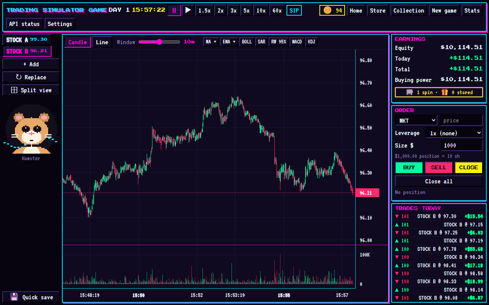
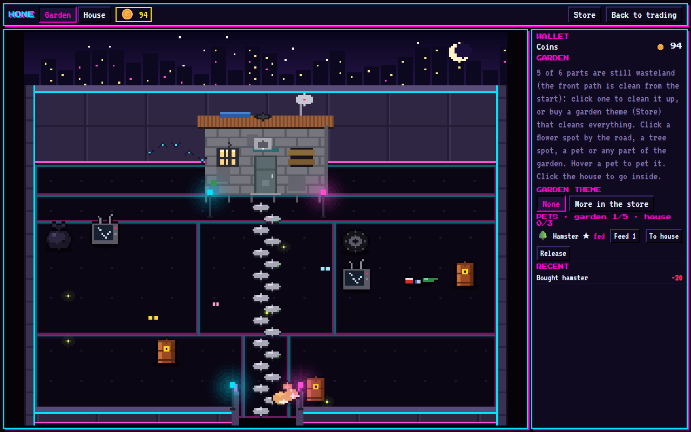

# Trading Simulator Game

A single-player, retro pixel-style day-trading practice game. It replays real US stock trades, second by
second, from a random day between 2020 and 2025, and hides which stock and which day it is, so you trade
the tape and not the headlines. Profits buy things for a pixel home: a garden, houses, pets, cars and an
aquarium. Educational only, not financial advice.





## Requirements

- Windows, macOS or Linux with **Python 3.11 or newer** (the desktop window uses
  [pywebview](https://pywebview.flowrl.com/); on Windows it uses the built-in Edge WebView2).
- A free **Alpaca paper-trading key** for the market data (see below). No bank account or ID is needed.

## Install and run

On Windows, double-click `start.bat`. The first run creates a local `.venv` and installs everything.

By hand, on any system:

```
git clone https://github.com/jerry2411111/trading-simulator-game.git
cd trading-simulator-game
python -m venv .venv
.venv/Scripts/activate        # Windows; on macOS / Linux: source .venv/bin/activate
pip install -r requirements.txt
python -m app
```

This opens Trading Simulator Game in its own desktop window (resize it by dragging any edge or corner; the app
always fills the window). To play in a browser instead, run `uvicorn app.main:app` and open
http://127.0.0.1:8000.

To build the ready-to-run Windows version yourself (an `.exe` that doesn't need Python), run
`packaginguild_windows.bat`; the result is in `dist\Trading Simulator Game`. It keeps its keys and
saves in a `data` folder next to the `.exe`.

## Getting the market-data key

The game downloads real trade data from [Alpaca](https://alpaca.markets), which gives free historical
market data. The first screen walks you through it:

1. Sign up at alpaca.markets (free, about 3 minutes, works from any country).
2. Open the **Paper Trading** dashboard and generate an **API key** (Key ID + Secret Key).
3. Paste both into the game's setup screen and press **Connect**.

Market data is fetched by your own machine with your own key and is never redistributed.

## Your keys and data stay on your computer

- Nothing personal is in this repository. Keys, saves and the downloaded data all live in the local
  `data/` folder, which is gitignored and never committed.
- The Alpaca key is kept in `data/keys.json` on your computer (or in `.env` if you are a developer, see
  `.env.example`). It is never logged and never sent to the browser page after you save it.
- The optional AI player's key (Anthropic or any OpenAI-compatible endpoint) stays in memory only, unless
  you tick "Remember on this computer". It is never included in the prompts.
- If you fork this project, keep `data/`, `.env` and `keys.json` out of your commits (the included
  `.gitignore` does this).

## Tests

```
pip install -r requirements.txt
python -m pytest
```

## How it plays

- **Hidden identity.** Stocks appear as STOCK A, STOCK B, ...; no date is shown; prices are rescaled so
  each stock opens at $100.00 on the day it joins the game, and every price move from there is made 3x
  bigger in percentage terms (100·(P/100)³) so there is more to trade; games saved before this keep 1x. Real tickers and
  dates never leave the backend.
- **Liquid stocks only** (at least 250,000 trades a day on average over the previous 20 trading days), so
  the 1-second chart has a trade in almost every second.
- **Chart.** Price and volume are always shown; volume is always bars, price is candles or a line. A
  slider sets how much time is visible (15 seconds to 90 minutes); the view follows the clock. Buys are
  marked with green triangles, sells with red ones.
- **Indicators:** MA (5/10/20/30/60/120) and EMA (5/9/12/20/26/50/100/200), each period ticked
  separately and labeled in a legend; Bollinger (20, 2σ), Parabolic SAR, MACD, KDJ, and a random-walk 95% band: at the start of every 5-minute block a band is fixed from the 1-second
  volatility σ of the 15 minutes before it, `P·exp(±1.96·σ·√h)`, reaching to the end of the block, so you
  can watch the price move through it.
- **Speeds:** pause, ▶ (real time), 1.5x, 2x, 3x, 5x, 10x, 60x. Chart window: 15 seconds to 90 minutes.
- **Orders:** MKT, LMT, and conditional "MKT if ≥ / ≤ price"; a fixed dollar size; BUY, SELL, CLOSE,
  Close all. No spread or slippage: market orders fill at the current 1-second close. Waiting orders
  and positions are closed at the end of each day.
- **Account:** $10,000 to start, leverage 1x–100x, fees $0.005/share ($1 minimum per order). Fees can
  be lowered but never below $0.001/share and $1 per order; the market-order spread can be 0. Money can't
  be added: mortgage your home (Store → Mortgage) instead, or start a new game / load a save. No target
  and no win screen; the game ends only if equity reaches $0.
- **Slot machine:** every 5 trades earns a spin. Spins are banked: pull the lever whenever you like from
  the 🎰 button in the Earnings box. Each prize goes into storage, and you choose when to use it (reveals
  are for the stock you're viewing, from the moment you use them). 30% shows the next 2 hours' highest and lowest price
  on the chart, 20% pays double the profit of your next closing trade, 10% makes your next closing trade
  unable to lose, 10% shows whether the stock closes up or down the next trading day, 10% gives 10
  trades without fee or spread, 10% gives 30 of them, 5% pays five times the profit of your next closing
  trade, and 5% gives a piece for your collection. Multipliers never apply to losses.
- **Collection:** 100 rare pieces (great artworks, tanks, dresses, crowns, jewels, classic cars, watches,
  instruments, relics, legends), rare to mythic, won as slot machine gifts and shown in lit glass
  cabinets in a museum showcase (Collection button). They can't be sold.
- **Stats:** end-of-day card and a Stats screen (return, max drawdown, Sharpe, Sortino, trades, win rate,
  fees, equity curve).
- **Settings** (the game pauses while open): 5 UI styles, trading settings (spread, fees), Clear PnL,
  save / load games, AI operation, exit. The game also autosaves to `data/state.json`.
- **AI operation:** enter your own AI API key (Anthropic, or any OpenAI-compatible endpoint), tick
  which data the AI receives (price, volume, indicators), and edit its role-play prompt. Every N game
  seconds the clock waits while the AI decides; it can place MKT, LMT and conditional orders with a
  price and size. The key stays on your computer (memory only unless you tick "Remember").
- **Your pet:** the head of your companion pet next to the chart. Focused when you're flat, expecting
  when your open position is winning, anxious when it's losing, happy (+$) or sad (−$) when a trade
  closes. Hover it to pat it. Pick the companion in the garden; hide it in Settings → UI style.
- Stocks: add up to 5, replace one, or stop following one with the ✕ on its tab (its position closes; one
  always stays).
- Keyboard: B buy, S sell, C close, Space pause / resume, 1–5 switch stock.

## Home and Store

Every game has its own home, saved with the game. Coins = this game's trading profit + income from the
home − what you spend. The game pauses while you're in Home, Store or Collection.

- **Garden:** sits inside a wall (the house stands in front of its back wall) and starts as a
  wasteland: one plain neon panel per part (black with a blue and pink edge) with garbage on it. The front path is clean from the start; pay to clean up each of the
  other five parts, then lay a floor (lawn, clover, gravel, brick,
  stone, wood deck, neon tiles, snow, circuit board, red lacquer tiles, royal lawn, zellige mosaic).
  Or buy a garden theme (Christmas, Chinese New Year, Cyberpunk, Halloween, Muslim garden, Royal garden): it cleans
  up everything, lays its ground, adds its decorations and dresses the trees; switch between owned themes
  for free. A stone road runs unbroken from the gate to the door, lined by two flower beds (6
  spots, 8 flowers that grow as full piles, bloom in 8 hours and sell
  for twice the seed price); four tree spots: pine, maple, apple, sakura and six cyberpunk trees (synth
  pine, neon palm, data tree, holo bonsai, crystal tree, fiber-optic willow) that grow in 1–4 days, then
  give a harvest every day or two; bees build hives in the real trees. A pool, a play corner, birds.
- **Pets:** 38 kinds: 10 dog breeds (Corgi, German Shepherd, Labrador, Golden Retriever, Poodle,
  Husky, French Bulldog, Bichon Frise, Pomeranian, Chihuahua), 10 cat breeds (Siamese, Orange Tabby,
  British and American Shorthair, Ragdoll, Persian, Maine Coon, Scottish Fold, Russian Blue, Bengal),
  rarer pets (sugar glider, hedgehog, leopard gecko, bearded dragon, ball python, chinchilla, ferret,
  pacman frog, capybara, marmoset), hamster, rabbit, guinea pig, parrot, turtle, a green anole and a
  lion. Prices follow real-world prices. Each has its own look, habits and portrait next to the chart.
  Pets are drawn roughly to real-world scale (a hamster or frog is tiny, a chihuahua small, a Labrador
  twice a cat, a capybara like a big dog, a lion bigger still). Cat breeds differ in build (slim
  Siamese / Russian Blue / Bengal, chubby British / Scottish / Persian, large Ragdoll and Maine Coon),
  ears, tail (whip or plume), coat and markings.
  Up to 5 pets live in the garden and 3 in the house (move them between the two); when both are full the
  store won't sell more. Pets can't be sold, only released for nothing. Pets of 1,000 coins or more open a
  portrait window in the house (pat, treat, play) and have three outfits designed for their breed.
  Each eats at a different price; hungry after 2 days without food, dead after 7 (real days).
- **House:** a concrete shack to start (with a shower, a toilet, a mattress on the floor and an old laptop);
  country house (4,000), Christmas cottage or modern house (level 2); haunted manor, modern villa, modern tower, Chinese palace, Muslim palace, St Sophia cathedral or the golden palace (level 3). Better
  houses are bigger in the garden and inside; the palaces fill the whole garden. Rooms are divided by
  walls; 51 kinds of furniture to place and rotate, plus paintings and windows that hang on the back wall.
  Buying a new house moves your furniture into it.
  Click the front door to go back out.
- **Garage and cars:** buy a garage (2,000) and it stands next to your house; a house of 4,000 or more has
  it built in (clicking the house asks: house or garage). Inside is a showroom: your car turns on a lit
  turntable (drag it, or let it turn by itself) and up to 5 cars wait in their bays. Cars are small voxel
  models: Toyota Corolla, Honda Civic, Hyundai Elantra; Toyota Camry, Honda Accord, Tesla Model 3, BMW 3
  Series; Mercedes-Benz S-Class, BMW 7 Series, Audi A8, Porsche 911, Porsche Panamera, Lexus LS, Range
  Rover, Bentley Continental GT and Flying Spur, Rolls-Royce Ghost and Phantom, Ferrari Roma and
  Lamborghini Huracán, priced close to real life. They sell back at half price and count in mortgages.
- **Fish and the aquarium:** a fish tank unlocks 12 kinds of fish (they swim in the tank). Upgrade it to
  the aquarium for sea life (starfish, seahorse, jellyfish, lionfish, moray eel, octopus, sea turtle,
  manta ray, shark, whale), then build the ice land in it for penguins, seals and sea dogs. Water animals
  get hungry after 2 days but never die.
- **Store:** buy everything; sell unused furniture, seeds and saplings back at half price.
- **Mortgage:** a house (worth $20,000 plus its price and the furniture in it), a building, a piece of
  furniture or the whole home (worth $20,000 plus everything in it except pets; that locks the home until
  it's paid back), on one of four plans: 150% of the value at 0.5% a
  day, 100% at 0.25%, 70% at 0.05% or 50% at 0.01%. The dollars go into the trading account and are not
  profit; paying back takes them out again. Interest is paid every trading day (interest only) from the
  account's cash at the close and counts as a loss; if the cash can't cover it, the bank takes the
  mortgaged thing and the loan is gone.

## Universe

`app/universe.json` is the seed list of stocks the game picks from. It is maintainer-editable.

Charts: [TradingView Lightweight Charts™](https://www.tradingview.com/lightweight-charts/) (Apache 2.0).

## License

MIT, see [LICENSE](LICENSE). Market data belongs to its providers and is not included.
